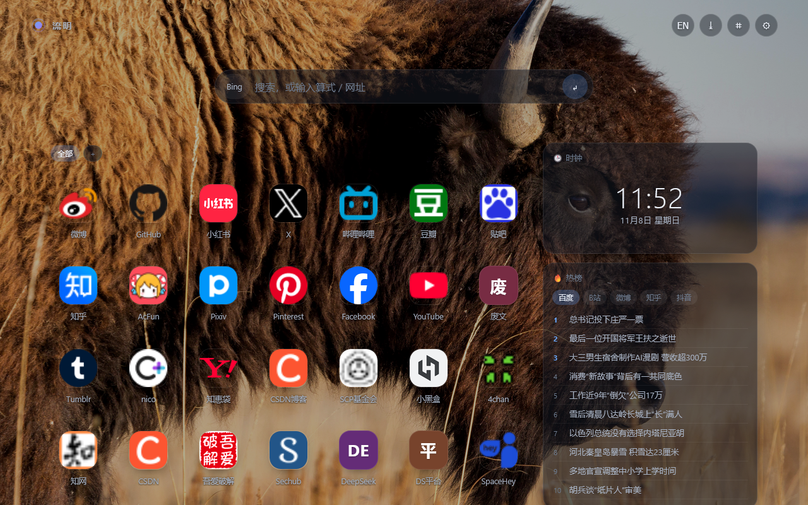

# 流明 · Lumen

一个给 Firefox 用的新标签页扩展。打开新标签，先看到自己的桌面：壁纸、搜索框、收藏的网站、几个常驻小组件。



## 安装（三步）

1. 到 [Releases](../../releases) 下载 `lumen-tab-1.0.2.xpi`，**存到磁盘上，不要解压**。
2. Firefox 地址栏输入 `about:addons` → 右上角齿轮 ⚙ → **从文件安装附加组件** → 选那个 xpi → 弹窗里点「添加」。
3. `Ctrl+T` 开新标签页。

> Firefox 74 之后不允许把 xpi 拖进窗口安装，只能走 `about:addons` 这条路。

## 里面有什么

| 组 | 内容 |
| --- | --- |
| 壁纸 | 必应每日一图（自动换）、纯色/渐变、本地图片（多张轮换）、模糊与暗化、按壁纸取主题色 |
| 搜索 | 多引擎（Tab 键轮换）、联想词、历史补全、算式直接算、中英互译、`Ctrl+K` 聚焦 |
| 图标 | 增删改、自动抓 favicon（DuckDuckGo → 直连，两次都失败就老实显示文字图标）、图标库、上传自定义图、文件夹、分组、拖拽排序、导入书签 |
| 组件 | 时钟、世界时钟、热榜（百度 / B站 / 微博 / 抖音）、待办、便签、网速测试、翻译、AI 问答、影视日历、RSS 订阅 |
| 布局 | 网格 / 自由摆放（拖到哪儿算哪儿）、图标五档尺寸、栅格列数间距、侧边栏 |
| 外观 | 明暗主题、主题色、字体、圆角、动效、自定义 CSS |
| 数据 | 全部存本地；导出/导入 JSON、自动备份五份、Firefox Sync、WebDAV |
| 其它 | 侧边栏（`Alt+Shift+S`）、右键菜单加链接、中英双语界面 |

## 快捷键

| 键 | 作用 |
| --- | --- |
| `Ctrl+K` | 聚焦搜索框 |
| `/` | 聚焦搜索框（页面内） |
| `Esc` | 失焦 / 关弹窗 |
| `Ctrl+Shift+B` | 立刻做一次备份 |
| `Tab` / `Shift+Tab` | 搜索框内切换搜索引擎 |

## 数据与隐私

- 没有账号，没有服务器，所有数据在浏览器本地（`storage.local`）。
- 联外请求只有这几处，都是可关的：必应每日壁纸、图标服务（DuckDuckGo，失败时直连站点）、你选的热榜源、`speed.cloudflare.com`（测速）、MyMemory（翻译）、豆瓣（影视日历）、你自己填的 RSS 源、你自己配的 AI 接口。
- 不做统计，不埋点。

## 已知限制

- 一个浏览器只能有一个扩展接管新标签页；装了两个会打架，先禁用旧的那个。
- 知乎热榜没有公开免 key 的接口，现在走的是镜像，可能失效；要稳定就改用「订阅」组件挂 RSS。
- 图标抓不到时就显示首字母，这不是 bug——它不会拿一张灰色占位图糊弄你。

## 自己改

```bash
# 打包
python build.py            # 产出 dist/lumen-tab-<版本>.zip

# 检查
npx web-ext lint --source-dir src

# 临时装进 Firefox 调试
npx web-ext run --source-dir src

# 签名（自用，AMO 未列出渠道）
npx web-ext sign --source-dir src --channel=unlisted --api-key=... --api-secret=...
```

目录结构：

```
src/
├── manifest.json
├── newtab.html          新标签页
├── sidebar.html         侧边栏
├── css/                 app.css / sidebar.css
├── js/                  main / grid / widgets / search / settings / wallpaper / favicon / store / ui / i18n / util / background / sidebar
├── icons/
├── data/nebula-seed.json   首次打开时铺的 67 个网址
└── _locales/            zh_CN / en
```

## 许可

MIT，见 [LICENSE](LICENSE)。
